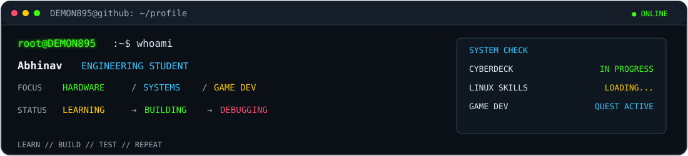
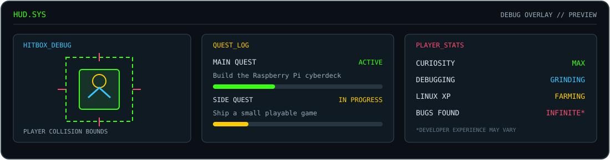
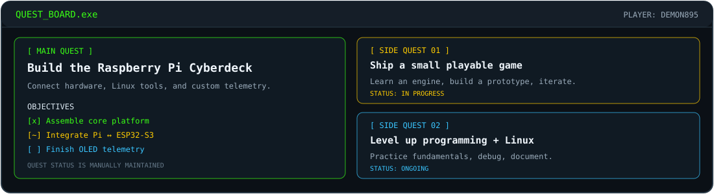

<div align="center">


[](https://github.com/DEMON895)
[](#-featured-builds)
[](#-system-profile)


</div>

---

## `> whoami`

<div align="center">
  
</div>

I'm exploring the space where **hardware, operating systems, software, AI, and game development** meet.

- 🧰 Building a portable Raspberry Pi cyberdeck with an ESP32-S3 companion node.
- 🪟 Experienced with multiple Windows versions and lightweight/custom Windows builds.
- 🐧 Learning Linux through hands-on setup, troubleshooting, and system tuning.
- 🎮 Working toward game development while strengthening software engineering fundamentals.

```text
[OK] CURRENT_MISSION  : Build useful things. Understand how they work.
[WAIT] NEXT_OBJECTIVE   : Turn experiments into documented, working projects.
[LOOP] BUILD_PHILOSOPHY : Learn -> Build -> Test -> Debug -> Repeat.
```

> **Terminal palette:** 🟢 `#39FF14` ready / active · 🟡 `#FFCC00` learning / in progress · 🔴 `#FF4D6D` alerts / next steps · 🔵 `#39C5FF` system information

*GitHub doesn't render arbitrary colored Markdown text consistently. The identity panel above is a custom SVG, so individual text labels can be green, yellow, red, and cyan without coloring the entire badge or block.*

### `> HUD / player_status`

<div align="center">
  
</div>

### `> QUEST_LOG / progression`

<div align="center">
  
</div>


## `> 02 // featured_builds`

<details open>
<summary><b>🧰 Raspberry Pi Cyberdeck | Main hardware project</b></summary>

A portable Linux workstation concept for offline knowledge, networking experiments, hardware telemetry, and a custom multi-display interface.

<div align="center">


</div>

| Module | Role |
|---|---|
| **Raspberry Pi 3B+** | Main controller, Linux workstation, offline knowledge, and high-level tools |
| **ESP32-S3 WROOM-1 N16R8** | Companion node for connectivity and edge experiments |
| **Display system** | 5-inch main display plus two 0.96-inch OLED status displays |
| **Software** | Linux/XFCE, Kiwix, Python, Scapy, and shell scripts |
| **Current focus** | Pi ↔ ESP32 communication, lightweight performance, and OLED telemetry |

**Build direction:** one compact setup that brings useful tools, system status, and connectivity into a portable workspace.

*Project status: actively evolving. Photos, wiring diagrams, and build notes will be added as the project is documented.*

</details>

<details>
<summary><b>🗓️ Intelli_Time | AI-assisted timetable concept</b></summary>

A responsive single-page web app exploring timetable optimization, interactive demonstrations, and visual explanations of AI scheduling.

[Open the repository](https://github.com/DEMON895/Intelli_Time)

</details>

<details>
<summary><b>🔎 Lost-and-Found App</b></summary>

A project focused on helping users report and find lost items.

[Open the repository](https://github.com/DEMON895/Lost-And-Found-APP-Project)

</details>

> **More builds incoming.** I prefer showing projects with real code, clear documentation, and working demos over listing tools without context.

## `> 03 // system_profile`

<table>
<tr>
<td width="50%" valign="top">

<div align="center">


</div>

I've worked with multiple generations of Windows, from older releases to modern systems and lightweight custom builds.

- Windows XP, 7, 8, 10, and 11
- ReviOS
- AtlasOS
- Tiny11

**Comfort zone:** Windows environments, customization, and performance-focused setups.

</td>
<td width="50%" valign="top">

<div align="center">


</div>

Learning Linux by using it, troubleshooting it, and building with it.

- Desktop environments and system setup
- Lightweight configurations and performance tuning
- Terminal commands and shell scripting
- Networking tools and troubleshooting
- Raspberry Pi and embedded Linux experiments
- Lab-based packet analysis with tools such as Scapy

**Current objective:** become more confident with daily Linux use and understand the system beneath the desktop.

</td>
</tr>
</table>

<div align="center">

</div>

## `> 04 // tools_and_technologies`

<div align="center">


</div>

*These labels describe what I'm learning or exploring, not equal proficiency in every technology.*

## `> 05 // current_objectives`

- Strengthen programming fundamentals and problem-solving.
- Practice data structures and algorithms for SDE placements.
- Build small, playable game-development projects.
- Learn Linux administration and system internals.
- Improve the cyberdeck's hardware/software integration.
- Document projects so others can reproduce and learn from them.

## `> 06 // github_telemetry`

<div align="center">


</div>

## `> 07 // connect`

I'm interested in learning from people building with Linux, embedded systems, networking, AI, and game development.

<div align="center">

[](https://github.com/DEMON895)

*Building one system at a time. More experiments incoming.*


`END OF TRANSMISSION // DEMON895`

</div>
